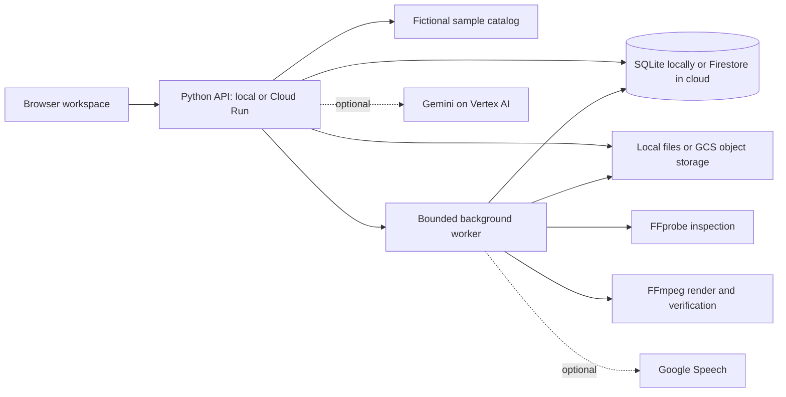

# Butler

A creator-first assistant for getting from a clip you own to a post-ready draft without handing over creative control. Butler helps shape an approved vertical edit and turns the creator's brief and optional transcript into an opening hook, on-screen title, caption, and hashtags.

The current build is a runnable **local prototype** of the attached BRD. Its primary story is the creator workflow; the equipment catalog is supporting context and uses fictional products with illustrative prices.

Product narrative and a short demo run-of-show: [`docs/pitch-story.md`](docs/pitch-story.md).

The original planning HTML is unchanged.

## Start

From this directory:

```powershell
python run.py
```

Open the URL printed by the runner, normally **http://127.0.0.1:8765**. If the port is occupied, the runner tries the next nine ports. Stop with Ctrl+C. You can also use `npm start`; no `npm install` is needed.

Required: Python 3.11+ (verified here with 3.14). Node 18+ is used for JavaScript tests, not for serving the app. Python 3.11-3.13 have not been tested on this laptop.

This implementation uses a browser ES-module frontend and Python HTTP server. Local mode uses SQLite and local files with no runtime Python dependencies. An optional Cloud Run mode uses Firestore and Cloud Storage through the Google Cloud Python client libraries in `requirements.txt`. No cloud resources or credentials are provisioned by the app, and no cloud service is claimed to be deployed or configured by this repository.

Run **one Butler instance per data directory**. A second independent instance must use a different `--data-dir` as well as a different port. The server intentionally accepts only loopback requests; do not expose it to a network or use it as a production server.

## What Works Locally

- Discover: text conversation, budget clarification, backend category/currency/budget filtering, and an honest no-match state.
- A 30-item **fictional sample catalog** covering microphones, lights, tripods, and headphones. Prices are illustrative. No retailer URLs, live availability, observation dates, or verified commercial claims are fabricated.
- Compare up to three products, including unknown attributes and source labels.
- Saved products, conversation history, preferences, captions, plans, jobs, and activity survive page refresh and server restart within a 24-hour session.
- Create: authorized MP4 upload, upload progress, draft framing, trim inputs, title, subtitle setting, manual transcript, editable captions, and Smart Shorten exports. Smart Shorten scans scene changes across the full clip, optionally uses Google Speech and Gemini visual analysis when configured, selects chronological excerpts or speeds up the full clip, supports mute/preserved audio, and can generate an original instrumental audio bed.
- Creator Pack: optional Gemini on Vertex AI turns the creator's brief and transcript into a hook, suggested video title, caption, and hashtags. Every field stays editable; render approval is still explicit, and Butler never publishes for the creator.
- Server media inspection, immutable plan approval, queued rendering, progress phases, one deliberate retry for retryable jobs, and verified output publication **when approved FFmpeg tools are configured**.
- Caption download works independently of the media tools. Completed renders offer MP4, caption text, optional SRT, and a ZIP post package. Exports include the latest saved caption edits.
- Optional Gemini on Vertex AI and Google Speech transcription through server-only REST adapters. These are not used by default and have not been exercised against live Google services here.

Local mode is explicitly labeled **Local rules**, not live AI. Creator Packs in local mode are deterministic examples; Gemini is used only when Vertex mode is configured. Shopping decisions and edit-plan constraints are deterministic. A compound shopping/content request starts with discovery; video approval remains an explicit UI action. Manual transcript timings are evenly spaced approximations, not speech-aligned recognition.

## Enable Video Processing

FFmpeg and FFprobe were not present on this laptop at build time. Obtain a **corporate-approved, current FFmpeg distribution** through your authorized internal software route. Do not change execution policy, use UAC, or bypass blocked download sites.

The build must include H.264 (`libx264`), AAC, the `drawtext` filter, the `subtitles` filter/libass, and usable fonts. Point Butler at the approved executables before starting it:

```powershell
$env:BUTLER_FFMPEG_PATH = 'C:\ApprovedTools\ffmpeg\bin\ffmpeg.exe'
$env:BUTLER_FFPROBE_PATH = 'C:\ApprovedTools\ffmpeg\bin\ffprobe.exe'
$env:BUTLER_FONT_PATH = 'C:\Windows\Fonts\arial.ttf'
python run.py
```

The paths above are placeholders, not an installed location. Restart Butler after changing configuration. An existing uploaded clip marked Tools required can then use **Retry inspection**.

Limits: one active render per session via the UI, five total upload reservations per session, 50 MiB per MP4, 60 seconds, maximum 3840 x 2160 in either orientation. Files need a real MP4 container, a supported video stream, finite duration, and bounded dimensions. Rejected media is removed. There is no fake playable result when tools are absent.

Output: 720 x 1280, 30 fps, H.264/AAC, letterbox or center crop, optional wrapped title and subtitles. FFmpeg receives argument arrays with restricted protocols; model text never becomes shell commands or filter expressions. Worker calls have time limits and a four-slot queue with two workers. A render worker holds a 240-second lease; expired processing leases and ten-minute dispatch delays become honest failed states.

## Enable Google Services

Cloud Run sets `K_SERVICE` and `PORT`; Butler binds to `0.0.0.0:$PORT` and obtains Google credentials from its runtime service identity using Application Default Credentials. The container selects Vertex AI, Firestore, and Cloud Storage. It refuses to start if Firestore or GCS is replaced with local persistence. Set `BUTLER_ALLOWED_HOSTS` to the exact Firebase Hosting hostnames (comma-separated, no wildcards); secure cookies are enabled in the container. Local mode continues to bind to loopback and use SQLite/local files.

Firebase Hosting is the Firebase product in this deployment: it serves `static/` and rewrites `/api/v1/**` plus `/health` to the `butler-api` Cloud Run service. `firebase.json` contains this route configuration. The configuration and adapters are not evidence of a live deployment; the project, Firestore database, private bucket, IAM, Gemini access, and actual service URLs still need to be configured and verified.

These steps require your approved Google Cloud project, enabled billing/APIs, model availability in the selected region, quotas, and IAM permissions. The app does not create or deploy cloud resources.

Configure an approved Google Cloud CLI installation and application-default authentication directly on your machine. Do not put tokens, keys, or service-account files in chat, source control, or the browser.

```powershell
gcloud auth application-default login
gcloud auth application-default set-quota-project YOUR_PROJECT_ID
$env:GOOGLE_CLOUD_PROJECT = 'YOUR_PROJECT_ID'
$env:GOOGLE_CLOUD_LOCATION = 'asia-south1'
$env:BUTLER_VERTEX_MODEL = 'gemini-3.5-flash'
$env:BUTLER_MODEL = 'vertex'
python run.py
```

As checked on October 17, 2026, Google's model guide lists Gemini 3.5 Flash as generally available and supports `asia-south1` ([model details](https://docs.cloud.google.com/gemini-enterprise-agent-platform/models/gemini/3-5-flash)). The adapter uses Vertex AI's `generateContent` REST endpoint and JSON response schema ([REST quickstart](https://docs.cloud.google.com/vertex-ai/generative-ai/docs/start/quickstart), [structured output](https://cloud.google.com/vertex-ai/generative-ai/docs/reference/rest/v1/GenerationConfig)). Confirm the API, billing, IAM access, quotas, and model access for your project before the demo. Override the model or region if your project requires it. This adapter requests the ADC access token from `gcloud`, caches it for 40 minutes, and makes bounded REST calls. It does not load service-account JSON files. Windows CLI invocation and live provider responses remain unverified until an approved CLI is available.

To enable automatic timed transcription, enable the Speech-to-Text API and grant the demo identity access, then set:

```powershell
$env:BUTLER_TRANSCRIPTION = 'google'
$env:BUTLER_SPEECH_LANGUAGE = 'en-IN'
```

Leave the transcript blank for automatic transcription; entered text overrides it with approximate manual timing. Regular trims transcribe only the selected segment. Smart Shorten analyzes the full source, maps detected speech into the selected excerpts, and uses Google Speech when `BUTLER_TRANSCRIPTION=google`. Set `BUTLER_MODEL=vertex` to add Gemini visual moment scoring from a one-frame-per-second contact sheet. Local mode still scans scene changes and speech when configured, then ranks moments without sending video frames to a cloud provider. The background-music choice creates an original instrumental bed locally and mixes it under source audio.

Provider failures are surfaced; the app never silently presents deterministic fixtures as live AI. At most one generation call per turn and one transient retry are used, below the BRD's four-call ceiling. Google calls incur your project's charges.

Environment variables are listed in `.env.example`. The file is documentation only: **the runner does not automatically load `.env` files**. Set variables in the terminal that starts the server.

## Access And Storage

- Optional `BUTLER_DEMO_PASSCODE` adds a demo access-code gate. Set it privately in the launch environment. It is not production identity management.
- Session cookies are HttpOnly and SameSite=Strict. Secure cookies are not enabled on the local HTTP server. CSRF tokens and exact Origin/Host checks protect mutation routes.
- Resource lookup always binds the current server session; client-supplied ownership is ignored. Missing and inaccessible resources return the same 404.
- In local mode, state and uploads live in `%LOCALAPPDATA%\ButlerPrototype`, **outside the OneDrive source folder**. Choose another local directory with `--data-dir` or `BUTLER_DATA_DIR` if needed.
- In Cloud Run mode, session/app records use Firestore and source videos/rendered artifacts use a configured GCS bucket. `/tmp` is only a processing cache; it is not the durable copy. Cloud mode is selected with `BUTLER_STORAGE=firestore`, `BUTLER_MEDIA_STORAGE=gcs`, and `BUTLER_MEDIA_BUCKET`. These modes are opt-in and require the setup below.
- Sessions expire 24 hours after creation. A cleanup thread checks expiry every five minutes while the app runs, removes session records and their media directory, and repeats at startup. Cleanup is not exact-time deletion and does not run while the application is stopped. OS deletion failures and expired-session cleanup require operational monitoring before production.
- Render download links are session-bound, HMAC-signed, and valid for ten minutes. Server restart invalidates old links; request fresh ones.
- Use only consented or synthetic inputs. No purchasing, checkout, social publishing, arbitrary browsing, or arbitrary command tool exists.

## Cloud Run, Firestore, Cloud Storage, And Hosting

The cloud path is wired in code and deployment configuration, but **has not been deployed or verified against a Google Cloud project**. The Cloud Run container build installs FFmpeg, FFprobe, and DejaVu fonts; codec/filter support, real rendering, cloud IAM, and Hosting rewrites must be verified in the target project before the demo. The current local check found Docker CLI 24.0.2, but no gcloud, Firebase CLI, FFmpeg, or FFprobe; the Windows Arial font is present but its Butler path variable is empty. The Docker daemon/image build and cloud services were not verified.

The API uses these Firestore collections, with every record tied to its owning session:

| Collection | Document key | Owner/data |
| --- | --- | --- |
| `sessions` | Random session ID | Session state, CSRF token, expiry, and hashed session-token index |
| `session_tokens` | SHA-256 of the browser token | Owning session ID and expiry; raw bearer token is never stored |
| `records` | `<kind>_<record-id>` | App records (messages, assets, plans, jobs, captions), each carrying `session_id`; reads also verify the owner |
| `approvals` | `<session-id>_<idempotency-key>` | Session-scoped plan/version/job approval record |
| `chat_requests` | `<session-id>_<request-key>` | Session-scoped idempotency response |

Media object keys are session-scoped (`{session_id}/assets/...` and `{session_id}/jobs/...`). The private GCS bucket is only accessed server-side after the API verifies the owning session; `/tmp` materializations are disposable processing cache. The local object adapter preserves SQLite/local-file mode. Do not point multiple local app instances at the same local data directory.

### One-time Google Cloud setup

1. Create/select the team's Google Cloud project, link billing, and add it as a Firebase project. Enable Cloud Run, Cloud Build, Artifact Registry, Firestore, Cloud Storage, Secret Manager, Firebase Hosting, and Vertex AI APIs.
2. Create a Firestore database in Native mode and a private Cloud Storage bucket in the same or nearby region. Configure a lifecycle rule for abandoned objects as an additional cleanup safeguard; the application also deletes objects when its 24-hour session records expire.
3. Create a dedicated Cloud Run runtime service account. Grant it `roles/datastore.user`, `roles/storage.objectUser` on the media bucket, `roles/secretmanager.secretAccessor` on the signing-key secret, and `roles/aiplatform.user` for Gemini on Vertex AI. Do not download service-account keys.
4. Create a Secret Manager secret named `butler-signing-key` with a random value of at least 32 characters. Keep the value out of source control and chat.
5. Install/use the approved `gcloud` and Firebase CLIs, authenticate, select the project, and deploy the service from this directory. Replace the placeholders and choose the Hosting domain/origins for this project:

```powershell
gcloud config set project YOUR_PROJECT_ID
gcloud run deploy butler-api --source . --region us-central1 --allow-unauthenticated --service-account butler-runtime@YOUR_PROJECT_ID.iam.gserviceaccount.com --set-env-vars GOOGLE_CLOUD_PROJECT=YOUR_PROJECT_ID,GOOGLE_CLOUD_LOCATION=asia-south1,BUTLER_VERTEX_MODEL=gemini-3.5-flash,BUTLER_MODEL=vertex,BUTLER_STORAGE=firestore,BUTLER_MEDIA_STORAGE=gcs,BUTLER_MEDIA_BUCKET=YOUR_PRIVATE_BUCKET,BUTLER_ALLOWED_ORIGINS=https://YOUR_PROJECT_ID.web.app\,https://YOUR_PROJECT_ID.firebaseapp.com,BUTLER_ALLOWED_HOSTS=YOUR_PROJECT_ID.web.app\,YOUR_PROJECT_ID.firebaseapp.com --set-secrets BUTLER_SIGNING_KEY=butler-signing-key:latest --no-cpu-throttling --min 1 --max 1 --concurrency 8 --timeout 900
```

The single-instance, always-allocated CPU settings keep this prototype's in-process render worker alive. This is a demo deployment constraint, not a horizontally scalable worker design. A production system should move rendering into a separately managed Cloud Run worker/queue.

6. The Dockerfile configures FFmpeg/FFprobe and a font path. After building, verify `ffmpeg -encoders` includes `libx264` and AAC and `ffmpeg -filters` includes `drawtext` and `subtitles`; verify the configured font exists. If organizational policy requires a different approved FFmpeg distribution, replace the Docker build package source accordingly.
7. Deploy Firebase Hosting (the static frontend is served from `static/`; `/api/v1/**` and `/health` rewrite to the deployed `butler-api` service in `us-central1`):

```powershell
firebase deploy --only hosting --project YOUR_PROJECT_ID
```

8. Open `https://YOUR_PROJECT_ID.web.app` and check Workspace status. It should show **Firestore**, **Google Cloud Storage (selected; access checked on upload)**, and FFmpeg/FFprobe/font presence. For a real Firestore write/read check, use this PowerShell session against the public Hosting URL:

```powershell
$origin = 'https://YOUR_PROJECT_ID.web.app'
$webSession = New-Object Microsoft.PowerShell.Commands.WebRequestSession
$created = Invoke-RestMethod -Method Post -Uri "$origin/api/v1/sessions" -ContentType 'application/json' -Body '{}' -WebSession $webSession
$workspace = Invoke-RestMethod -Uri "$origin/api/v1/bootstrap" -WebSession $webSession
$workspace.capabilities.storage
```

The last command must return `Firestore`; the create-session request writes the session and token index, and bootstrap reads them back. Confirm matching session/token-index records in the Firestore console. This verifies actual Firestore traffic, not just the UI label. Then upload one short consented clip and verify its object in the private bucket, followed by inspection, approved render, preview, and object-backed exports before presenting the demo.

Cloud Run deployment requires public invocation for Firebase Hosting's Cloud Run rewrite unless project-specific IAM is configured for the integration. The app's optional demo passcode is a demo gate, not managed identity. Local uploads allow 50 MiB; Cloud Run is capped at 30 MB because this app uses an HTTP/1 server and Cloud Run's HTTP/1 request limit is 32 MiB. The app proxies uploads through the API; signed direct-to-GCS uploads are not implemented.

The container is configured to call Gemini on Vertex AI using the Cloud Run service identity (ADC); no token or key belongs in an environment variable. A configured model is not proof of a successful Gemini call: verify a Creator Pack request against the deployed URL and record its result before claiming Gemini is live. Local runs continue to default to local rules.

## Tests

```powershell
python run.py --test
```

This is also `npm test`. It runs Python unit/real-HTTP integration tests, JavaScript syntax checks, and six Node UI helper tests. Tests isolate SQLite/media in temporary directories and do not need cloud credentials. Model/media-boundary unit tests use explicit stand-ins; they are not evidence of a real video render.

The real FFmpeg integration test generates a synthetic clip, trims/renders it with title/subtitles, verifies an edited caption in the ZIP, and checks duplicate execution. It **skips explicitly** until FFmpeg, FFprobe, and a font are configured. Run it before claiming video rendering readiness.

Browser flows were checked using VS Code's integrated Playwright tools. See `docs/acceptance-results.md` for observed results and unverified boundaries.

## Layout And API



```text
app/core.py        catalog, validators, SQLite transactions, approval/idempotency
app/firestore_store.py Firestore implementation of session/record/idempotency contract
app/storage.py     local and GCS media-object storage interface
app/server.py      local/Cloud Run HTTP API, ownership/CSRF, retention, safe file serving
app/providers.py   optional Vertex AI and Google Speech adapters
app/media.py       FFprobe inspection, FFmpeg worker, subtitles, ZIP export
static/            responsive UI, generated bitmap imagery, local icon font
data/products.json fictional sample catalog
tests/             isolated domain, HTTP, media, and UI helper checks
```

All application routes are under `/api/v1`. Sessions are established with `POST /sessions`; all other API routes require the cookie, and mutations additionally require `Origin` and `X-CSRF-Token`.

| Route | Purpose |
| --- | --- |
| `GET /bootstrap` | Session, capabilities, retained messages/plans/assets/jobs/captions |
| `PUT /session` | Validated preferences, saved products, selected product IDs |
| `POST /chat` | Message plus unique `client_message_id`; duplicate IDs reuse responses |
| `GET /products` | Category, `max_price_minor`, currency filtering |
| `POST /products/compare` | One to three catalog IDs |
| `POST /assets/upload-url` | Reserve one server-chosen upload location with declared size and consent |
| `PUT /assets/{id}/upload` | Single-use, cookie/CSRF-authorized streamed binary upload |
| `POST /assets/{id}/complete` | Queue inspection or deliberately retry after tool setup |
| `GET /assets/{id}` | Safe inspection metadata and status |
| `GET /assets/{id}/preview` | Owned validated source video with range support |
| `POST /edit-plans` | Validated immutable proposed plan |
| `POST /edit-plans/{id}/approve` | Exact version and idempotency key; create/return one durable job |
| `GET /jobs/{id}` | Job status, phase, safe error, and retry eligibility |
| `POST /jobs/{id}/retry` | Same job, one deliberate retry for allowed failure codes |
| `GET /jobs/{id}/preview` | Verified completed video |
| `GET /jobs/{id}/downloads` | Fresh session-bound short-lived artifact links |
| `POST /captions` | Confirmed product IDs, creator brief, optional transcript, tone; returns an editable Creator Pack |
| `PUT /captions/{id}` | Retain edited text and hashtags |
| `GET /captions/{id}/download` | Current authorized caption text |

Errors use `{ "error": { "code": "...", "message": "...", "request_id": "..." } }`. Outputs never disclose cloud credentials, signed links in logs, or internal exception text.

## Remaining BRD Work

The adapters above are **not a verified cloud deployment**. Remaining work includes approved dependency setup, Firestore/GCS IAM and lifecycle configuration, live cloud acceptance, a separately managed Cloud Run worker/queue, managed identity, signed direct-to-GCS uploads, production isolation/observability, real verified retailer data, and measured cloud latency. A React/FastAPI migration is needed only if the hackathon requires it.

Optional scope not implemented: queued-job cancellation, multiple presets, advanced transcription correction/timing, and dashboards. Shopping prose uses basic local intent rules unless Vertex is configured; it is not a general-purpose agent.

Validate live provider access, five real supported clips, privacy cleanup, ownership, crash recovery, and three complete rehearsals before claiming the original BRD's success criteria. No production readiness, live price coverage, or measured performance improvement is claimed.

Product images are original bitmap illustrations generated using browser Canvas. The local tool icons use the Codicons font bundled with the installed VS Code; attribution and upstream licensing are recorded in [THIRD_PARTY_NOTICES.md](THIRD_PARTY_NOTICES.md). Windows fonts are referenced by name, not redistributed.
