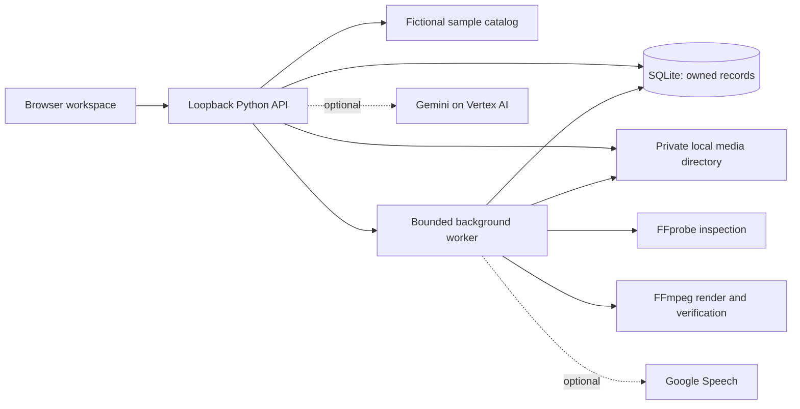

# Butler

A runnable **local prototype** of the attached BRD: equipment discovery, product comparison, owned-video preparation, explicit edit approval, caption editing, and export.

The original planning HTML is unchanged.

## Start

From this directory:

```powershell
python run.py
```

Open the URL printed by the runner, normally **http://127.0.0.1:8765**. If the port is occupied, the runner tries the next nine ports. Stop with Ctrl+C. You can also use `npm start`; no `npm install` is needed.

Required: Python 3.11+ (verified here with 3.14). Node 18+ is used for JavaScript tests, not for serving the app. Python 3.11-3.13 have not been tested on this laptop.

This implementation uses a browser ES-module frontend, Python's standard-library HTTP server, and SQLite instead of React/FastAPI/Firestore. Those dependencies are not installed and the corporate-approved package source has not been supplied. There are **no pip or npm runtime dependencies**, CDN scripts, cloud credentials in the browser, or policy bypasses.

Run **one Butler instance per data directory**. A second independent instance must use a different `--data-dir` as well as a different port. The server intentionally accepts only loopback requests; do not expose it to a network or use it as a production server.

## What Works Locally

- Discover: text conversation, budget clarification, backend category/currency/budget filtering, and an honest no-match state.
- A 30-item **fictional sample catalog** covering microphones, lights, tripods, and headphones. Prices are illustrative. No retailer URLs, live availability, observation dates, or verified commercial claims are fabricated.
- Compare up to three products, including unknown attributes and source labels.
- Saved products, conversation history, preferences, captions, plans, jobs, and activity survive page refresh and server restart within a 24-hour session.
- Create: authorized MP4 upload, upload progress, draft framing, trim inputs, title, subtitle setting, manual transcript, and editable captions.
- Server media inspection, immutable plan approval, queued rendering, progress phases, one deliberate retry for retryable jobs, and verified output publication **when approved FFmpeg tools are configured**.
- Caption download works independently of the media tools. Completed renders offer MP4, caption text, optional SRT, and a ZIP post package. Exports include the latest saved caption edits.
- Optional Vertex AI explanations/captions and Google Speech transcription through server-only REST adapters. These are not used by default and have not been exercised against live Google services here.

Local mode is explicitly labeled **Local rules**, not live AI. Shopping decisions and edit-plan constraints are deterministic. A compound shopping/content request starts with discovery; video approval remains an explicit UI action. Manual transcript timings are evenly spaced approximations, not speech-aligned recognition.

## Enable Video Processing

FFmpeg and FFprobe were not present on this laptop at build time. Obtain a **corporate-approved, current FFmpeg distribution** through your authorized internal software route. Do not change execution policy, use UAC, or bypass blocked download sites.

The build must include H.264 (`libx264`), AAC, the `drawtext` filter, the `subtitles` filter/libass, and usable fonts. Point Butler at the approved executables before starting it:

```powershell
$env:BUTLER_FFMPEG_PATH = 'C:\ApprovedTools\ffmpeg\bin\ffmpeg.exe'
$env:BUTLER_FFPROBE_PATH = 'C:\ApprovedTools\ffmpeg\bin\ffprobe.exe'
$env:BUTLER_FONT_PATH = 'C:\Windows\Fonts\arial.ttf'
python run.py
```

The paths above are placeholders, not an installed location. Restart Butler after changing configuration. An existing uploaded clip marked Tools required can then use **Retry inspection**.

Limits: one active render per session via the UI, five total upload reservations per session, 50 MiB per MP4, 60 seconds, maximum 3840 x 2160 in either orientation. Files need a real MP4 container, a supported video stream, finite duration, and bounded dimensions. Rejected media is removed. There is no fake playable result when tools are absent.

Output: 720 x 1280, 30 fps, H.264/AAC, letterbox or center crop, optional wrapped title and subtitles. FFmpeg receives argument arrays with restricted protocols; model text never becomes shell commands or filter expressions. Worker calls have time limits and a four-slot queue with two workers. A render worker holds a 240-second lease; expired processing leases and ten-minute dispatch delays become honest failed states.

## Enable Google Services

These steps require your approved Google Cloud project, enabled billing/APIs, model availability in the selected region, quotas, and IAM permissions. The app does not create or deploy cloud resources.

Configure an approved Google Cloud CLI installation and application-default authentication directly on your machine. Do not put tokens, keys, or service-account files in chat, source control, or the browser.

```powershell
gcloud auth application-default login
gcloud auth application-default set-quota-project YOUR_PROJECT_ID
$env:GOOGLE_CLOUD_PROJECT = 'YOUR_PROJECT_ID'
$env:GOOGLE_CLOUD_LOCATION = 'us-central1'
$env:BUTLER_VERTEX_MODEL = 'YOUR_AVAILABLE_GEMINI_MODEL'
$env:BUTLER_MODEL = 'vertex'
python run.py
```

`YOUR_AVAILABLE_GEMINI_MODEL` must be verified in your project. The code's configurable default is `gemini-2.5-flash`; availability is not guaranteed. This local adapter requests the ADC access token from `gcloud`, caches it for 40 minutes, and makes bounded REST calls. It does not load service-account JSON files. Windows CLI invocation and live provider responses remain unverified until an approved CLI is available.

To enable automatic timed transcription, enable the Speech-to-Text API and grant the demo identity access, then set:

```powershell
$env:BUTLER_TRANSCRIPTION = 'google'
$env:BUTLER_SPEECH_LANGUAGE = 'en-IN'
```

Leave the transcript blank for automatic transcription; entered text overrides it with approximate manual timing. The worker transcribes only the selected segment, so timestamps are output-relative. Silent clips need subtitles disabled or a manual transcript.

Provider failures are surfaced; the app never silently presents deterministic fixtures as live AI. At most one generation call per turn and one transient retry are used, below the BRD's four-call ceiling. Google calls incur your project's charges.

Environment variables are listed in `.env.example`. The file is documentation only: **the runner does not automatically load `.env` files**. Set variables in the terminal that starts the server.

## Access And Storage

- Optional `BUTLER_DEMO_PASSCODE` adds a demo access-code gate. Set it privately in the launch environment. It is not production identity management.
- Session cookies are HttpOnly and SameSite=Strict. Secure cookies are not enabled on the local HTTP server. CSRF tokens and exact Origin/Host checks protect mutation routes.
- Resource lookup always binds the current server session; client-supplied ownership is ignored. Missing and inaccessible resources return the same 404.
- State and uploads live in `%LOCALAPPDATA%\ButlerPrototype`, **outside the OneDrive source folder**. Choose another local directory with `--data-dir` or `BUTLER_DATA_DIR` if needed.
- Sessions expire 24 hours after creation. A cleanup thread checks expiry every five minutes while the app runs, removes session records and their media directory, and repeats at startup. Cleanup is not exact-time deletion and does not run while the application is stopped. OS deletion failures and expired-session cleanup require operational monitoring before production.
- Render download links are session-bound, HMAC-signed, and valid for ten minutes. Server restart invalidates old links; request fresh ones.
- Use only consented or synthetic inputs. No purchasing, checkout, social publishing, arbitrary browsing, or arbitrary command tool exists.

## Tests

```powershell
python run.py --test
```

This is also `npm test`. It runs Python unit/real-HTTP integration tests, JavaScript syntax checks, and six Node UI helper tests. Tests isolate SQLite/media in temporary directories and do not need cloud credentials. Model/media-boundary unit tests use explicit stand-ins; they are not evidence of a real video render.

The real FFmpeg integration test generates a synthetic clip, trims/renders it with title/subtitles, verifies an edited caption in the ZIP, and checks duplicate execution. It **skips explicitly** until FFmpeg, FFprobe, and a font are configured. Run it before claiming video rendering readiness.

Browser flows were checked using VS Code's integrated Playwright tools. See `docs/acceptance-results.md` for observed results and unverified boundaries.

## Layout And API



```text
app/core.py        catalog, validators, SQLite transactions, approval/idempotency
app/server.py      loopback HTTP API, ownership/CSRF, retention, safe file serving
app/providers.py   optional Vertex AI and Google Speech adapters
app/media.py       FFprobe inspection, FFmpeg worker, subtitles, ZIP export
static/            responsive UI, generated bitmap imagery, local icon font
data/products.json fictional sample catalog
tests/             isolated domain, HTTP, media, and UI helper checks
```

All application routes are under `/api/v1`. Sessions are established with `POST /sessions`; all other API routes require the cookie, and mutations additionally require `Origin` and `X-CSRF-Token`.

| Route | Purpose |
| --- | --- |
| `GET /bootstrap` | Session, capabilities, retained messages/plans/assets/jobs/captions |
| `PUT /session` | Validated preferences, saved products, selected product IDs |
| `POST /chat` | Message plus unique `client_message_id`; duplicate IDs reuse responses |
| `GET /products` | Category, `max_price_minor`, currency filtering |
| `POST /products/compare` | One to three catalog IDs |
| `POST /assets/upload-url` | Reserve one server-chosen upload location with declared size and consent |
| `PUT /assets/{id}/upload` | Single-use, cookie/CSRF-authorized streamed binary upload |
| `POST /assets/{id}/complete` | Queue inspection or deliberately retry after tool setup |
| `GET /assets/{id}` | Safe inspection metadata and status |
| `GET /assets/{id}/preview` | Owned validated source video with range support |
| `POST /edit-plans` | Validated immutable proposed plan |
| `POST /edit-plans/{id}/approve` | Exact version and idempotency key; create/return one durable job |
| `GET /jobs/{id}` | Job status, phase, safe error, and retry eligibility |
| `POST /jobs/{id}/retry` | Same job, one deliberate retry for allowed failure codes |
| `GET /jobs/{id}/preview` | Verified completed video |
| `GET /jobs/{id}/downloads` | Fresh session-bound short-lived artifact links |
| `POST /captions` | Confirmed product IDs, context, tone |
| `PUT /captions/{id}` | Retain edited text and hashtags |
| `GET /captions/{id}/download` | Current authorized caption text |

Errors use `{ "error": { "code": "...", "message": "...", "request_id": "..." } }`. Outputs never disclose cloud credentials, signed links in logs, or internal exception text.

## Remaining BRD Work

This is **not the deployed cloud architecture**. Remaining work includes approved dependency setup and a React/FastAPI migration if required by the hackathon, Firestore and private Cloud Storage adapters, separate Cloud Run worker deployment and service accounts, managed identity, signed cloud uploads, cross-origin storage CORS, production isolation/observability, real verified retailer data, and measured cloud latency.

Optional scope not implemented: queued-job cancellation, multiple presets, advanced transcription correction/timing, and dashboards. Shopping prose uses basic local intent rules unless Vertex is configured; it is not a general-purpose agent.

Validate live provider access, five real supported clips, privacy cleanup, ownership, crash recovery, and three complete rehearsals before claiming the original BRD's success criteria. No production readiness, live price coverage, or measured performance improvement is claimed.

Product images are original bitmap illustrations generated using browser Canvas. The local tool icons use the Codicons font bundled with the installed VS Code; attribution and upstream licensing are recorded in [THIRD_PARTY_NOTICES.md](THIRD_PARTY_NOTICES.md). Windows fonts are referenced by name, not redistributed.